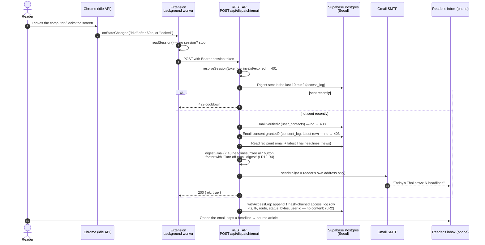

# D5 — Sequence: email digest when the reader is away (F3, LR1–LR4)

Drawn from the code as built on `main` (17 Nov 2026): `extension/src/background/index.ts`, `web/app/api/dispatch/email/route.ts`, `web/lib/logging.ts`, `web/lib/digestEmail.ts`, `web/lib/email.ts`. Before this, the reader has signed in with an emailed code (LR3) and turned on the email digest on the Settings page (LR4 consent recorded).

**Legend.** Solid arrow = call; dashed arrow = response. `alt` = the cooldown branch. Every request — success or error — writes exactly one `access_log` row (rule.md CCA §26). The API only ever emails the caller's own verified address; there is no admin or bulk send.
