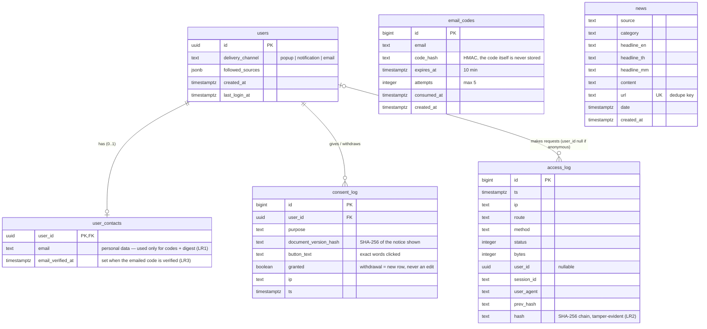

# D6 — Entity-Relationship: the Supabase database

Drawn from the table definitions as built: `web/lib/db.ts` (app tables) and the crawler's `news` table (`crawler/src/supabaseNews.ts`, `crawler/sql/001_news_url_category.sql`). All tables live in one Supabase Postgres database in Seoul (ap-northeast-2). Row Level Security is on for the app tables (commit 4a784b6).

**Notes.** `email_codes` is keyed by email, not by user, because a code is sent before the user exists. `news` has no link to users: everyone gets the same digest. `access_log` and `consent_log` are append-only (the app's database role has INSERT/SELECT only, `web/sql/001_app_role.sql`); `access_log` is kept ≥ 90 days. The `news` table was created in the Supabase dashboard, so only the columns the code reads or writes are shown; `url` is its unique key (`news_url_key`).
